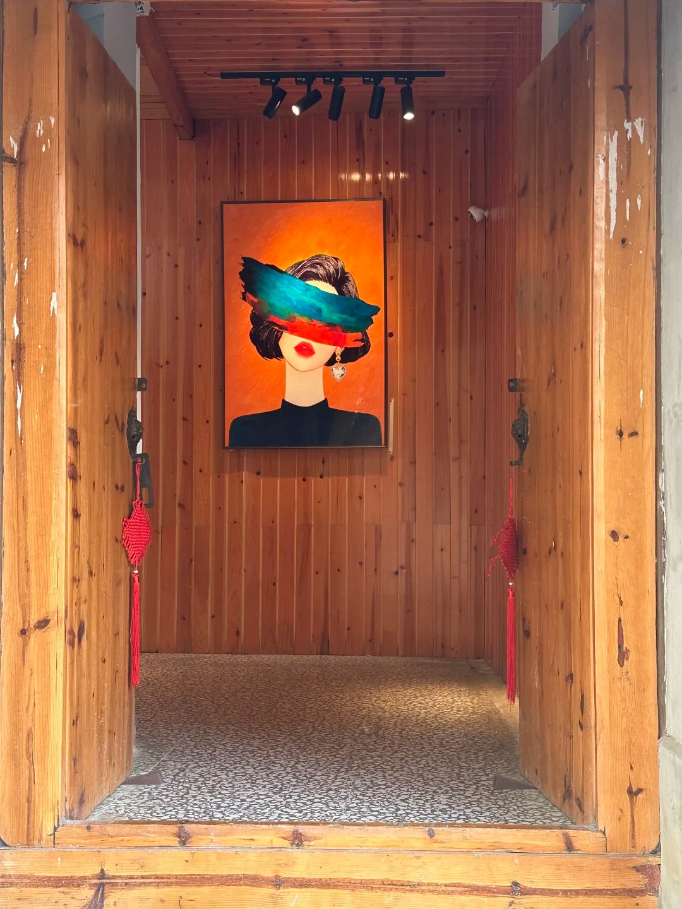

Last month, the noodle shop next door was closed for more than twenty days. I later found out that the owner had been ill and needed surgery.

From May to July, she ran the shop all by herself, from 7 a.m. to 11 p.m., for two whole months. Her younger brother had been hospitalized, and her husband had to go to the hospital every day to take care of him.

“I told her she could just close the shop around seven or eight in the evening when she was running it alone, but she wouldn’t listen. Now she’s ended up in the hospital herself, and she’s lost ten or twenty thousand yuan.” Said her husband.

[Chinese version](https://xhslink.cn/o/9Vpjo9Q4rwk)

A friend of mine has been telling me every day how stressed she is because she can’t get her models to work. Just sitting down at her desk makes her feel sick and brings her to tears.

I really understand what she’s going through — the stress response, the physical symptoms of emotional distress. But I don’t know what to say to make things better. So I sent her some milk-flavored pastries, hoping that something sweet might cheer her up a little.

We used to work so hard at our studies, hoping to land a job that was “easy” and “respectable.” Yet somehow, treating mental health problems can cost even more than treating physical illnesses.

Today marks four months since my little café opened. I’m one-sixth of the way through my original plan. But I haven’t really pushed myself this month. I’ve spent half the time slacking off and doing very little. I even took a little trip just for fun.

Travel is good for the soul. Looking at beautiful clouds and the sea lifts my spirits. Walking several kilometers a day makes my body feel good, too.

We work to afford a comfortable life, not to spend our money trying to buy back our health.

