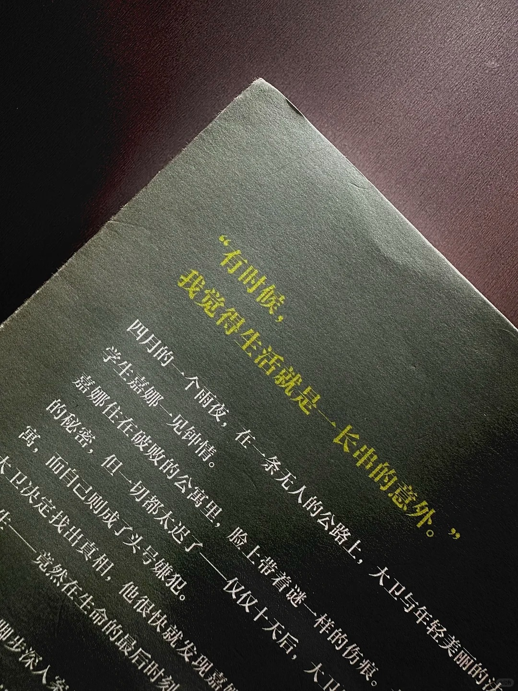
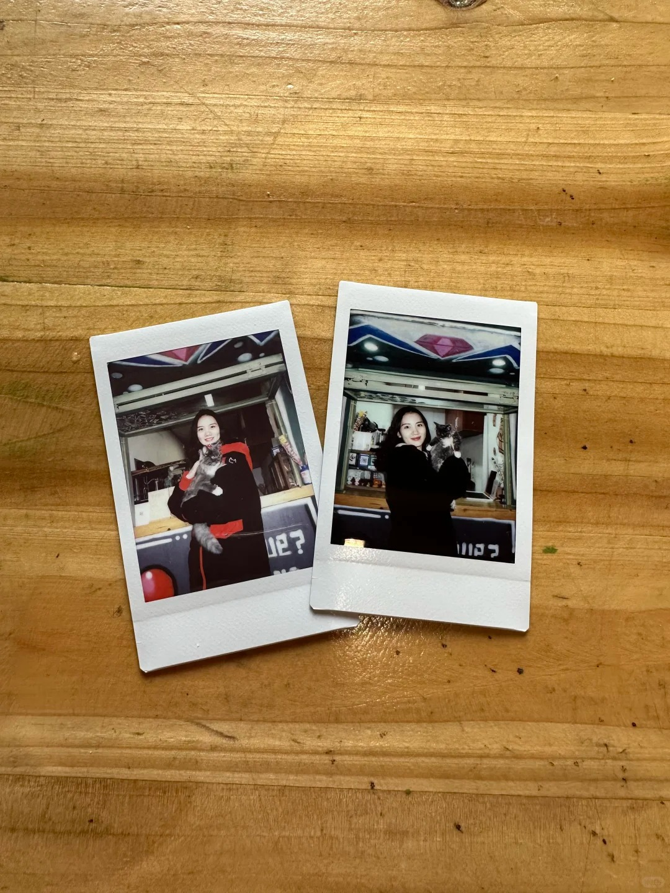

When my friends saw the news that I was suddenly transferring my café to someone else, they asked what had happened. One said they hadn’t even had the chance to come by for a cup of coffee.

[Chinese version](https://xhslink.cn/o/5LHWLZ6LFw5)

<!--more-->

Others had been planning to visit and check out the place for a while, but somehow, every time they came, I wasn’t there. Now, they’ll never get another chance.

My friends call me a person of action. My family calls me someone who acts on a whim.

But you see, life is full of unexpected turns. If you don’t act when you feel like doing something, chances are you may never get around to it.

Since 2020, my life has been one turning point and unexpected twist after another. Not a single step has gone in the direction I originally planned.

Six years ago, I never imagined that I’d spend three of those years on a career break, whether by choice or by circumstance. That I’d try more than ten wildly different jobs before finally finding something I truly loved and was good at. That I’d come to the conclusion that “life has no meaning,” and then stop worrying about this false question altogether…

It’s just one week away from the first anniversary of my café’s official opening. I’d already written the caption for my anniversary post. There was still so much content I hadn’t gotten around to sharing.

From today on, all of it will remain tucked away in my notes, never to be published.

So I guess this is how it ends: a rather hurried goodbye to my little café.